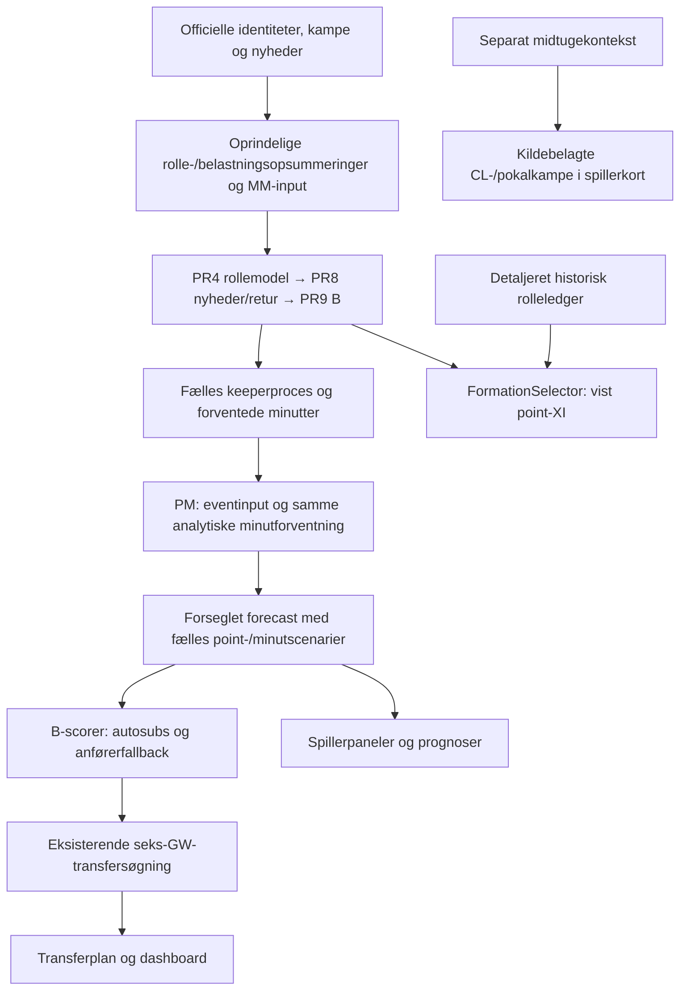

# Samlet krav- og testgennemgang: FPL Analytics B

Opdatering 23. oktober: Rolle-/importance-koblingen og ældre sæsoners brugerflade har en særskilt [implementerings- og leveranceopfølgning](2026-10-23-b-role-history-release.md). Tabellen nedenfor beskriver den oprindelige auditversion og er bevaret som historik.

## Konklusion

Den tekniske B-kæde fungerer på det kontrollerede aktuelle datagrundlag: fælles forecast-identitet, gyldige minut-/pointsummer, lovlige seks-GW-overgange og visning i den eksisterende desktopapp. Det er **ikke** dokumentation for, at alle aftalte mekanismer er implementeret, eller at hele modellen har valideret prognosekvalitet.

Der er registreret **56 konkrete krav** fra den tilgængelige samtale. Hvert krav er knyttet til brugerens ønske, implementering, testbevis, status og begrænsning. Detaljerne findes i [kravoversigten](../../analysis/results/full-chain-review-20261022/requirements.md), [CSV](../../analysis/results/full-chain-review-20261022/requirements.csv) og [JSON](../../analysis/results/full-chain-review-20261022/requirements.json). En funktionstestet række betyder, at den beskrevne funktion er kontrolleret; den betyder ikke en uafhængigt certificeret prognoseforbedring.

To eksplicitte fuldstændighedsgrænser: Den oprindelige liste bag brugerens accept af “alle de 5 ting” fremgår ikke entydigt af den tilgængelige samtale (A02). Brugerens faktiske lokale browserhold, herunder Ødegaard/Groß og købspriser, er ikke tilgængeligt her (T03). Ingen af delene erklæres automatisk opfyldt. Der er ikke opfundet brugerhold, priser eller gamle krav for at gøre oversigten grøn.

## Hvad den aktive kæde faktisk gør

Diagrammet viser de kontrollerede grænser, ikke alle interne komponenter. Oprindelige upstream- og PM-kanaler har også rolleinformations- og præstationsbidrag. De må ikke forveksles med, at den downstream viste formationsfordeling påvirker B's startchancer, eller at den nye kontekstvisning automatisk genberegner modellen.

## Trinvis vurdering

| Trin | Det, der er kontrolleret | Det, der fortsat mangler eller begrænser konklusionen |
| --- | --- | --- |
| Datakilder/identitet | Unikke spillere, kampnøgler, snapshot-/filhashes og kildeadskillelse | Ufuldstændig historisk Europa-dækning og publikationsure; tidligere sæsoner er ikke gjort tilgængelige i den samme apphistorik |
| Tilgængelighed | Officielle nyheder, kendte udlån, keeperkonkurrenter og hard-out-regler | Ikke certificeret faktisk hierarki for alle spillere; data er tidsstemplede observationer, ikke garantier |
| Roller/formationer | Fleksible roller og mulige opstillinger, inklusive Doku–Cherki–Foden | Detaljeret assignment ligger efter marginalerne; ingen feedback fra netop denne kombination til startchancerne |
| Match importance | Eksisterende funktioner, tests og inputkolonner gennemgået | Den detaljerede selector ignorerer importance-vægte; en valideret rolle×kommende-kamp-fordeling mangler |
| MM | Sandsynlighedsstøtte, minutter, outfield-startmasse og fælles GK-dækning | Undergruppekalibrering, fremtidige skade-/rolleforløb og usikkerhedsintervaller er ikke fuldt valideret |
| PM | Fælles analytiske minutter, pointdele, eksisterende hændelser og straffesparkshierarki | Hændelsestid for røde kort, selvmåls scoringseffekt og særlige FPL-assisttyper er ufuldstændige; små pointgevinster er ikke sikkert etableret |
| TS | Lovlige køb/salg, positioner, klubkvoter, bank, FT, hits, autosubs og C/VC | XI/bænk/transfersøgning er heuristisk; fuldt sæsonafkast og chip-optionsværdi er ikke dokumenteret |
| Backend | Ny aktuel syntetisk privat seks-GW-kørsel på den rigtige B-worker | En syntetisk kørsel beviser ikke korrektheden af brugerens faktiske private hold |
| App | Desktop/mobil, historik, spillerkort, midtuge, sandsynligheder, transferresultat, dashboard og tidsstempler | Ældre sæsoner og model-estimeret fraværsårsag er ikke fuldt leveret; nyere nyheder kan være advisories uden at ændre de eksisterende xP-tal |
| Drift/isolation | B-identitet og produktionsfiler matcher den aktuelle publiceringskvittering; originale TS-defaults bevaret | Ingen ny produktionscertificering eller uafhængig helsæsonvalidering udledes af funktionstests |

## Konkrete prioriterede huller

1. **Rollefordeling og kampprioritering skal hænge sammen før de endelige marginaler fastlægges.** Genbrug de eksisterende rolle- og importance-komponenter; test kompatible alternative opstillinger og konkurrencen mellem fleksible spillere. Foden kan allerede spille til højre ifølge dataene. En UI-positionsændring eller et manuelt Cherki-boost løser ikke arkitekturen. Se [rolle-/importance-audit](2026-10-22-role-importance-wiring.md).
2. **Rotation, tabt rolle og skade kræver særskilt evidens og generel validering.** Den afprøvede europæiske residual var ikke en dokumenteret løsning på rolleproblemet. Den tilsigtede recovery-undergruppe blev dårligere i 2024/25; der var kun 11 relevante markspillerrækker i 2025/26. Kommende CL-kamp må ikke rekonstrueres bagud fra et efterfølgende, realiseret kampprogram. Se [rotationstesten](2026-10-22-european-rotation-test.md).
3. **Kalibrering og usikkerhed skal vurderes separat fra matematiske identiteter.** Keeperreglen havde kun to berørte valideringskampe. De eksisterende minutintervaller er ikke uafhængigt kalibreret; 400 simulationsudfald er ikke et konfidensinterval for xP. Funktionelle scorer og gevinstintervaller omkring nul må ikke omtales som sikker modelgevinst.
4. **PM's sjældne hændelser og særlige assists er ikke fuldstændige.** Der er negative point for kort/selvmål, men ikke hele den kausale hændelseskæde. Det er en konkret modelbegrænsning, ikke en fejl i den verificerede sum af pointdele.
5. **TS fungerer, men er ikke bevist optimal eller bedre over en sæson.** Udvælgelse af XI/bænkrækkefølge og beam search er heuristisk. Hele seks-GW-kørslen er testet; et uafhængigt historisk transferpolicy-/chipafkast er ikke.
6. **Data og brugerflade har dækningsgrænser.** Apphistorikken er nuværende sæsons GW1–7; ældre researchsæsoner er ikke automatisk brugeradgang. Den faktiske lokale personlige holdtilstand er en særskilt verifikationsgrænse. A02's oprindelige fempunktsliste er åbent registreret.

Afslutningsevne, modtagerkonvertering og ekstra vægt på svære mål er **bevidst ikke indført efter test**, ikke glemt. De eksisterende forsøg giver ikke grundlag for at genåbne dem som nødvendige implementeringsrettelser eller konkludere, at fysisk afslutningsevne er irrelevant. Se [generel afslutningstest](2026-10-20-general-finishing-test.md).

## Testmetode og afgrænsning

Denne gennemgang følger krav → aktive kodeveje → konkrete påstande → testbevis. Eksisterende historiske point-/minutmetrikker er uafhængigt genberegnet fra de beholdte predictionstabeller; de er ikke omtalt som nye historiske simuleringer. De oprindelige perioder er genbrugte forskningsperioder med dokumenterede klokkeproxies. Resultater fra tidligere modelversioner er ikke sammenlagt med den aktuelle publicerede identitet.

Den aktuelle test bruger model `B-MM-PM-TS-v1`, forecast `053393cc593f7116f6c0758bacf84e97db502e338b685db1c5e68328a5310671`, data-as-of **22. oktober 2026 kl. 15.58.53 dansk tid** (13:58:53 UTC), 668 spillere, 60 kampe og 4.008 spiller/kamp-prognoser over GW8–13. Den nye private remote-regression blev gennemført kl. 19.17 dansk tid. Den er tydeligt syntetisk og udfører ingen officielle FPL-handlinger. Private jobnøgler, testhold, købspriser og fulde planer er kun beholdt i `/tmp` og er ikke i de offentlige auditfiler.

En ældre dashboard-browsertest forventede, at nyere nyheder altid blokerede en plan. Det strider mod den senere aftalte snapshot-politik. Testen er rettet til eksplicit at kontrollere både legacy-blokering og B-snapshot-advisory efter den aktuelle mode; ikke til at skjule en fejlet assertion. Mock-health annoncerer nu den capability, klienten kræver. Den nye skadesfixture bruger konsistent FPL-status `d` og 25% chance. Snapshot-browsertesten kan desuden indlæse SHA-kontrollerede, faktisk downloadede testinput fra disk, fordi Node's native fetch ikke brugte miljøets proxy. Browseren tilgår stadig den rigtige HTTPS-app med TLS-verifikation. Ingen produkt- eller modelfiler er ændret af disse testrettelser.

De endelige testkvitteringer og den samlede status findes i [verification-summary.json](../../analysis/results/full-chain-review-20261022/verification-summary.json). Se også [aktuel numerisk kædekontrol](../../analysis/results/full-chain-review-20261022/served-chain.json) og [genberegnede historiske metrikker](../../analysis/results/full-chain-review-20261022/historical-metric-recheck.json).

## Endelige kontroller

- 812 Python-tests bestod på 61,67 sekunder.
- Alle 27 JavaScript-testsuites bestod med eksplicit syntetisk holdfixture og det matchende aktuelle forecast.
- Ni browsersuites bestod på både desktop og mobil: historik, spillerkort, midtuge, fælles modelidentitet, transferresultat, offentlig readiness, snapshot-politik, dashboard og visning af det nye remote-resultat.
- Den aktuelle numeriske audit gennemgik alle 4.008 spiller/kamp-rækker og 120 klub/kamp-keepergrupper samt alle seks lovlige TS-overgange. En separat syntetisk kørsel på den rigtige private B-worker bestod også. Det testede forecast-id var uændret ved afsluttende offentlig genkontrol.
- Alle 88 faktisk hentede produktionsfiler matchede publiceringskvitteringens SHA256. Den originale TS-matematik/default-validering bestod den eksisterende adapterkontrol.

Reproducer den aktuelle read-only numeriske kontrol med `PYTHONPATH=src:scripts:. OPENBLAS_NUM_THREADS=1 /workspace/fpl-venv/bin/python analysis/audit_served_b_chain.py --capture /tmp/fpl-full-chain-public --fixture /tmp/fpl-full-chain-fixture.json --out analysis/results/full-chain-review-20261022/served-chain.json`. Den offentlige kildecapture og den syntetiske fixture er lokale testinput; private jobnøgler og fulde resultater offentliggøres ikke.

CI-afgrænsning: Den ældre desktop-workflow er stadig bundet til et ældre model-run og har en eksisterende `[full-chain]`-afgrænsning. Den er ikke brugt som bevis for den nye model. Den aktuelle audit bygger på de nye eksplicitte lokale/remote/browserkvitteringer. Den brede `scripts/**`-trigger kan genstarte numeriske researchruns ved auditkodeændringer; denne read-only audit er derfor placeret under `analysis/`, så read-only gennemgangen ikke i sig selv udløser endnu en fuld MM/PM-genopbygning.
