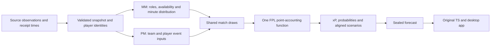

# Data to player points: the B forecast path

This is the entry map for maintaining the current B chain. It describes implemented code and its limits; it does not replace historical references or certify forecasting accuracy. The offline analytic-PM/odds experiment remains separate. Cleanup must preserve existing numbers before any model change is considered.



## One owner for each decision

| Stage | Code entry | Owns | Must not do |
|---|---|---|---|
| Source collection / reconstruction | `scripts/build_current_b_inputs.py::build` and retained upstream source manifests | Observations, player/fixture identity, source clocks, source files | Treat missing observations as confirmed absences or invent an earlier acquisition time |
| MM / role inference | `scripts/mm_candidate_forecast.py::infer_B` | Starting/bench probabilities and duration inputs from existing MM | Estimate player goal/assist points |
| Exact MM/PM join | `scripts/mm_locked_bridge.py::attach_mm` | Unique player/fixture/club/position/cutoff join; replace designated minute fields | Change frozen control exposure used to derive PM event propensities |
| Event input adapter | `src/fpl_v1_1_model/fixture_input.py::prepare_fixture`, through `scripts/run_vfinal_integrated.py::make_vfinal_input` and the existing `phase4b.py::player_to_sim_input` | Team goal means, assist weights, defensive contributions, discipline, saves, penalty parameters, bonus background | Confuse allocation weights with final expected goals |
| Final B minute contract | `scripts/run_joint_gk_preview.py::run`, `scripts/b_chain_contract.py::prepare_match`, `scripts/gk_joint_bridge.py::prepare` | Shared outfield role distribution, mean-preserving durations, exclusive GK coverage and current penalty ranks | Build a second independent minute forecast inside PM or TS |
| Separate ordinary-goal head | `scripts/nonpenalty_goal_bridge.py::calculate` | Selected NP-only history, priors and ordinary allocation weights | Blend penalty goals back into the ordinary head or overwrite the frozen penalty fallback |
| Match event generation | `src/fpl_v1_1_model/joint_simulator.py::simulate_match` | Shared sampled appearances, goals, assists, conceded goals, saves, defensive contributions, cards; BPS and joint bonus award | Charge a point component twice |
| FPL point rules | `src/fpl_v1_1_model/point_accounting.py` | One implementation of nonbonus point components and their total | Generate random events or estimate minutes |
| Aggregate and uncertainty export | `joint_simulator.py::simulate_many`, `scripts/pm_preview_distributions.py::simulate_with_distributions` | xP and probabilities from the same match draws; aligned TS samples | Re-simulate a separate forecast just to produce probabilities |
| Seal and export | `src/fpl_v1_1_model/forecast_snapshot.py`, `scripts/export_joint_gk_preview.py` | Content identity, complete horizon and source-bound output | Combine an old forecast with newer prices or another scenario set silently |
| Transfer search | `service/preview_manager_job.py::calculate`, `scripts/b_preview_ts.py::preview_scoring` | Original six-GW search, legal squad/budget/autosubs/captain behavior, shared PM scenarios | Independently predict player points |

The source tree contains older adapters and experimental implementations. They are not new production alternatives simply because they exist. Follow the entry points above; retained replay references must remain reproducible.

## Inputs and point contributions

| Contribution | Existing input / event | Calculation owner |
|---|---|---|
| Appearance | MM distribution → sampled `minutes` | 1 point for playing, another at 60 minutes |
| Ordinary goals | Team goal means, NP-only ordinary weights, actual active players | Shared ordinary-goal event allocation, then position-specific FPL points |
| Penalty goals / misses | `lambda_pen`, ranked available takers or frozen fallback, conversion | Separate penalty event process; scored penalties enter goal points, misses enter negative points |
| Assists | `assist_mu`/control exposure → allocation weights, team assist probability | Existing conditional event allocation excluding the selected scorer |
| Clean sheets | Opponent goal events while player is present, 60-minute threshold | Position-specific clean-sheet points |
| Saves / penalty saves | `lambda_saves`, calibrated save buckets, penalty-miss/save process | Keeper save buckets and five points per penalty save |
| Defensive contributions | `mu_dc`/control exposure, `dc_alpha`, duration and season | Existing count distribution and position threshold; historical 2024/25 rules retained |
| Discipline / own goals | `p_yellow`, `p_red`, `p_own_goal` | Existing competing card events and direct deductions |
| Conceded goals | Goals conceded during sampled on-pitch interval | GK/DEF deduction per two conceded goals |
| Bonus | Sampled BPS components, correct season rules and `bg_mean_rate90`/`bg_sd90` | Joint bonus allocation across the match, after nonbonus accounting |

For each player/fixture:

`xP = appearance + goals + assists + clean sheets + saves + penalty saves + defensive contributions + negatives + conceded-goal deductions + bonus`

All contributions here are expectations of the same sampled outcomes. `penalty_miss_points` is a diagnostic **subset of negative points**, not another term in that sum. The same applies to separating penalty goals from total goal points: display the split without adding it twice.

`goal_mu`, `assist_mu` and `control_xmins` are historical adapter inputs. They are not the final player xG/xA/xM to display after B adjustments. `goal_weight` is an allocation propensity; the actual recipient probabilities depend on which teammates are on the pitch. The selected NP head overrides ordinary weights separately.

## The two minute representations

MM exports analytic probabilities and xM from its minute distribution. PM produces a finite sample of that distribution, currently commonly 400 draws. Therefore `pm_analytic_minutes` must equal MM xM, while `simulated_minutes` can fluctuate. TS uses the aligned sampled scenarios from the same sealed forecast. Do not overwrite analytic xM with a noisy sampled mean or invent another independent distribution to make the numbers match.

The single-pass implementation records minutes, starts, points, ordinary goals and penalty outcomes during aggregation. It removes the former replay pass while preserving the exact old outputs. It halves the number of match-sampler calls made by this particular preview function; it does not claim the entire forecast workflow is twice as fast.

## Inspect any player's existing forecast

```sh
PYTHONPATH=src:scripts:. python scripts/trace_player_points.py \
  --forecast path/to/forecast.json \
  --inputs path/to/exact-current-B-inputs \
  --np-head path/to/nonpenalty-goal-head.csv.gz \
  --player 560 \
  --out player-560.json
```

Omit `--player` to inspect everyone; use an output name ending `.gz` for compressed JSON. `--player` is the official FPL element ID, not a name match. The NP file is optional, but missing NP evidence is explicitly marked unverified. The tool validates the forecast seal, full B contract, exact source-file hashes, player/club identities, point reconciliation and (when supplied) selected NP weights. It explains existing values rather than fitting a model.

Each row has `upstream_PM_inputs → selected_NP_head → MM → PM → TS`, plus the exact forecast seal. Upstream context fields show available input values, **not a causal explanation of how much each feature changed xP**. Never label this as a fresh prediction or fresh news collection.

## Known limits remain visible

- Shared match draws do not currently guarantee a fully valid joint outfield substitution timeline. This cleanup does not fix that numerical model issue.
- Reported FPL minutes do not obey a universal exact 900-minute team-sum rule. Do not reintroduce that invalid rejection criterion.
- Roles and some performance evidence use all-competition history. Explicit workload/last-start coverage is still partly PL-only. Upcoming CL priority/rest inference is partial; structured coach-quote inference is not implemented.
- Sampling probabilities are not proof of independent calibration or parameter uncertainty. The historic and current receipt clocks must be interpreted as documented.
- Production and public B remain on their reviewed pinned releases until an explicit release validation is completed. A source cleanup commit is not an app deployment.

## Cleanup acceptance

Keep the existing feature set, coefficient values, event dependencies, supported APIs and random draw order. For every extraction, compare unchanged real fixture inputs and seeds before and after, checking every event field, point component, BPS/bonus, intervals, generator state, aggregate, probability and TS scenario. Run the full regression suite. Update source-integrity pins only with a documented parity receipt; never disable a guard to get tests to pass.

## Optional competition context and prospective calibration

The next tested data path is documented in `analysis/results/competition-context-20261025/README.md`. It reuses canonical all-competition events, preserves authoritative PL inputs, keeps club roles separate from transferable physical load, and represents missing minutes through the existing missingness channels. `scripts/competition_context.py::apply_physical_context` is opt-in and is not called by the active publisher. The numerical upstream screen passes noninferiority but does not establish stable start-probability or xP improvement; it is not promoted. `analysis/score_prospective_player_forecast.py` can score the existing timestamped forecast ledgers once real final results exist. These additions do not change the current data-to-points ownership or resolve joint substitutions.

## Shared fixture input contract

The implemented three-table player/team/match boundary and its exact compatibility checks are documented in [Shared fixture input](shared-fixture-input.md). The normal PM entry point now uses this contract; it is not merely a diagram or an alternative experiment. The contract preserves all source columns, validates ownership/identity/cutoffs, and passes the same numerical inputs to the existing model.
