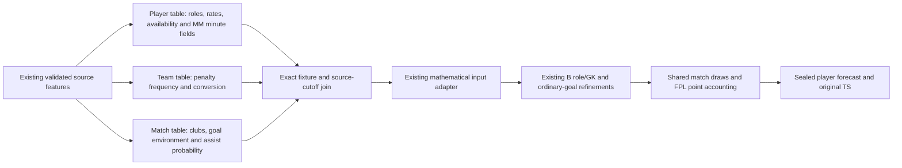

# Shared player, team and match input

The PM entry point now uses one shared contract: `src/fpl_v1_1_model/fixture_input.py`. This is a behavior-preserving assembly change. It does not fit coefficients, change MM/PM weighting, activate experimental competition context or fetch new data.

## Path



MM still owns its learned role/start/minute estimates and the exact MM/PM join. This contract organizes their output together with player and team event inputs at the inference boundary; it does not replace historical feature collectors or turn PM into an independent minute estimator.

## Three tables, one mathematical input

| Table | Keys | Owned data |
|---|---|---|
| `FixtureTables.players` | fixture UUID, cutoff, player UUID, canonical team ID | All remaining original feature columns, including MM fields, role/news/workload context, player event rates, penalty-taking weights and BPS background |
| `FixtureTables.teams` | fixture UUID, cutoff, canonical team ID | `lambda_pen`, `team_pen_conversion` |
| `FixtureTables.match` | fixture UUID, cutoff | `home_team_id`, `away_team_id`, `lambda_home_goals`, `lambda_away_goals`, `assist_probability_per_goal` |

`prepare_fixture_tables(...)` joins them and returns `PreparedFixture`, containing the tables, fixture identity/cutoff, the existing immutable `MatchSimInput`, and the legacy own-goal-input-present flag. The tables are owned copies for inspection, not deeply immutable objects. They must not be mutated during inference.

The existing `scripts/run_vfinal_integrated.py::make_vfinal_input` is a compatibility entry point. It loads the same selected keeper penalty-save parameter, calls `prepare_fixture`, and returns the same pair as before. BPS season selection and subsequent B role/GK/NP refinements remain where they were. Historical callers keep their existing API.

## Validation before mathematics

- One exact fixture with two different canonical clubs; both player and team tables must contain those clubs.
- Unique player IDs and unique team rows. Conflicting team values cannot be silently read from the first player's row.
- Matching timezone-aware source cutoffs. A team input from another snapshot cannot be mixed into the player input.
- Exclusive feature ownership. A team/match field cannot also be supplied by the player table.
- Required player rates and team/match values must be finite. Unknown required values are rejected, not filled with zero. Unconsumed optional/context features may remain missing.
- Original player ordering is preserved, because it also affects seeded random draws and aligned scenarios.
- Every original source feature survives splitting and joining. No new inference uses arbitrary extra columns: the established adapter still explicitly selects its mathematical fields. A test proves that added target-label/context columns cannot affect the model input.

Existing optional behavior remains explicit: if an old source does not contain own-goal probabilities, its existing fallback is retained and the presence flag remains false. Nonkeeper save inputs are irrelevant to keeper save scoring. This cleanup does not introduce new imputation or change established propensity conversion/clipping.

## Inspect the input

```python
from fpl_v1_1_model.fixture_input import split_fixture_frame
from run_vfinal_integrated import make_vfinal_input

tables = split_fixture_frame(one_fixture_feature_rows)
print(tables.match)
print(tables.teams)
print(tables.players[["player_uuid", "team_id", "pos", "goal_mu", "assist_mu"]])

match_input, has_own_goal_evidence = make_vfinal_input(one_fixture_feature_rows)
```

Separate feature producers may pass `FixtureTables` directly to `prepare_fixture_tables`; the existing pipeline passes its composed frame through `prepare_fixture`. Both use the same join and construction code, not competing models.

`goal_mu` and `assist_mu` are source means converted to on-pitch propensities using the frozen control exposure. They are not final displayed expected goals/assists after B minute/role/NP refinements. The selected nonpenalty head remains separate from penalty fallback weights. Final xP is still the expected sum of the existing point components, exported with aligned scenarios to TS.

## Evidence and scope

`analysis/results/fixture-input-contract-20261025/` contains exact before/after fingerprints for 98 current/historical fixtures: mathematical input values and player ordering, aggregate xP/components, probabilities, penalty split and raw scenarios are identical. The reference source is commit `fbfed1f`.

Every original feature value and dtype also round-trips exactly for **all 60 fixtures / 4,014 player-fixture rows / 669 players across GW9–14** of the saved reviewed 24 October source snapshot. This is a code-equivalence check, not a fresh forecast or a new six-GW transfer-policy backtest.

The NP source-integrity guard now additionally pins the shared contract, legacy compatibility entry, existing pair/propensity adapters and parity receipt. Fitted models and acceptance thresholds are unchanged. Production and the active B publication are not redeployed by this cleanup. Known substitution-process and incomplete competition-data limitations remain separate.
