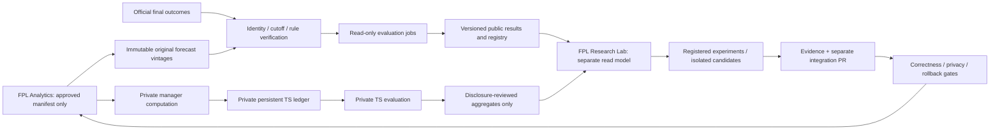

# Permanent architecture — two products, versioned exchange

This is a design, not a deployed Research Lab. No app, worker, public workflow or production model changes are included in this planning branch.

`Analytics ↔ versioned data/forecasts ↔ Research Lab` is the permanent boundary. Analytics emits original model/data snapshots and can later consume an explicitly approved new version. The Lab writes experiment/result namespaces and proposals; it has no write access to the live model pointer. A registry state change or dashboard interaction cannot deploy a model.

## Components and ownership

| Component | Boundary and reuse |
| --- | --- |
| Production manifest | Pinned model/source/fit/input/scoring schema IDs. App reads only this pointer; experimental IDs cannot appear silently. Existing Pages publication/rollback mechanism reused only by a separately reviewed release. |
| Public forecast archive | Reuse the actual public Git publication history and existing prospective capture receipts; retain full original six-GW vintages and common scenarios. A recovery after deadline is eligible only with a genuine original before-deadline witness. |
| Private TS ledger | Direct private worker output after successful original source/window validation. Explicit persistent mount, ownership/permission checks and private retention/backup policy; never transit GitHub or public report directories. PR43 remains draft and blocked. |
| Outcome/version store | Official final/data_checked labels, fixture/team/player-code mapping and scoring-rule version. New corrections create outcome revisions and new result versions; forecast bytes are immutable. |
| Evaluation runner | Pure scoring of archived input, not model refitting/simulation. Idempotent per forecast/outcome/code hash; retries cannot overwrite prior evidence. Public runner cannot read private TS paths or capability secrets. |
| Research registry | Immutable protocol IDs plus append-only events/results/decisions. Git review is the authoring path initially; no browser PAT or unreviewed public edit endpoint. |
| Lab read model | Versioned public JSON contract. Pages hosts public model accuracy, registry and non-private evidence only. Private manager views call a separate authenticated/capability backend and use no-store; no raw state is embedded in static assets. |
| Candidate sandbox | Separate model ID, fit, input set and output namespace. Parameter explorer does not write to production. Compute budgets and provenance apply before execution. |

## GW state machine

`awaiting_forecast → original_captured → awaiting_final_labels → labels_verified → evaluated → report_validated → published`.

Every stage can produce a typed `blocked`/`failed` state with reason and retry information. Missing forecast/labels/private state is never a zero error or zero score. Completion of a public model report does not imply private TS evaluation is available.

At predeadline capture validate season/GW, source cutoff ≤ issue/publication < deadline, exact identity and hashes, source age under the existing snapshot policy, full horizon, fixture schedule and shared-scenario alignment. A GitHub workflow start time alone is not proof a snapshot existed before deadline. Public publication receipts and any independent timestamp witness must be identified as such; local system clocks are weaker evidence.

After final labels, score origin-GW points once per player; per-fixture MM probabilities remain fixture targets. Do not split aggregate DGW draws into invented fixture draws. If the frozen schedule differs from the final schedule, apply a predeclared quarantine/target policy and report coverage, rather than revising the forecast. Duplicate players, mismatched stable codes, unknown score events and missing source provenance fail the contract.

For TS preserve recommendation, user intention and verified execution as independent event types. An absence of intention is unknown, not “follow model.” Browser-reported execution remains unverified until trusted official evidence is linked; an entry-ID claim alone is not proof of ownership. A local hash chain detects corruption but not a complete rewrite by the same administrator. Long-term private Lab access cannot rely only on the current one-hour job capability: define authenticated ownership or recoverable secret capabilities, retention/deletion, private backups and encryption/key management before a private history UI. A public FPL entry ID is not authentication.

## Minimal public report / dashboard contract

Each report has `schema_version`, `result_id`, `experiment_id`, `model_id`, `model_code_sha256`, `fit_sha256`, `forecast_sha256`, `input_vintage`, `origin_gw`, `information_cutoff`, `publication_witness`, `outcome_sha256`, `outcome_revision`, `evaluator_sha256`, `scoring_rule_version`, `generated_at`, `status`, `coverage`, `metrics`, `calibration`, `groups`, `uncertainty_method` and `limitations`.

A metric has target/unit, row count, fixture count, GW count, prediction definition, comparator, effect estimate, uncertainty/support status and evidence class. `not_identified`, `pending` and `missing` have explicit reasons. Forecast BPS error is not filled from bonus means. Risk-ceiling estimates carry model/information-set assumptions and may be Not Available indefinitely.

The contract lists only public forecast/player/match information and privacy-reviewed aggregates. It forbids manager IDs, owned squad, purchases/sale prices, bank/FT, user nominations, private keys and row-level policy trajectories. No public artifact upload uses a wildcard that could include a private directory. A single-manager aggregate may still reveal the manager; public TS disclosure requires a separate policy, not an assertion that aggregation is automatically anonymous.

## Workflow and permissions design

Reuse existing original-forecast and weekly-review Actions, but keep scorer publication separate from Pages/model deployment. Initial delivery should add a report-only manual job, then a scheduled final-GW poll after end-to-end tests. Use least-privilege read access to public snapshots and explicit output allowlists. No private storage credentials or manager input in a public Action. Private capture runs at the private compute boundary, not in the public reporter.

Persist report versions beyond an ephemeral artifact's retention if the project relies on them as long-term evidence. Original public Git snapshots and typed source receipts remain the source of truth. Do not rerun an expensive simulator merely to refresh charts. A planned or draft workflow is not described as active.

## Controlled promotion

Research result → candidate-specific review → independent reproduction → new out-of-sample/downstream evidence → separate integration PR → exact baseline numerical/regression comparisons → privacy/cutoff/rollout/rollback checks → approved versioned release → continuing monitoring. No acceptance event, parameter slider, automatic GW job or statistically significant result changes production by itself.

## Implementation dependency

PR43 is explicitly WIP. Its frozen-worker test exposed a boundary role vocabulary mismatch (`GK bench`/`Bench 1…3` versus `BGK`/`B1…3`). Repair that boundary without changing TS and preserve original rows/hashes. Public collector, DGW/blank and durable storage gates remain unfinished. This planning branch neither incorporates nor deploys its pipeline code.
