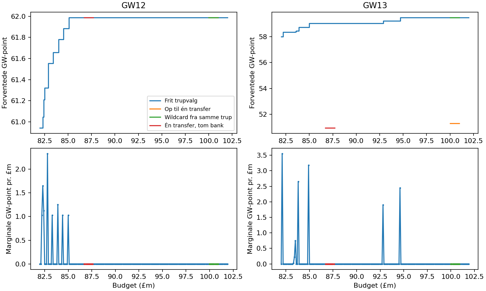

# FPL Research B · Kapitalallokering og skyggepriser

Budgettet gav **0 ekstra forventede GW-point pr. £0,1 mio.** ved alle opryk i intervallet £98–102 mio. i de to undersøgte prognoseudgivelser. Ved lavere budgetter blev kurverne trinvise. I GW13 gav et frit Wildcard-trupvalg fra £100 mio.-casen **8,18 flere forventede GW-point** end bedste ene transfer ved samme budget. Det er værdien af større handlefrihed i denne case. Begge kurver var flade ved dette budget.

Der foreligger ingen historisk hold-out-effekt i sæsonpoint. Det verificerede prognosearkiv havde den 28. november 2026 otte revisioner med origin GW12 og to med origin GW13, alle fra 2026/27. GW13 havde endnu ingen afsluttede udfald. Arkivet leverer derfor ingen fuld sæson med de krævede originale prognoser og prisøjebliksbilleder. GW1, GW10, GW20, GW30, kapitalens sæsonværdi omkring Wildcard og afvejningen mellem point nu og kapital senere står åbne. [Arkivets datakontrakt](../../integration/research-data/C1_DATA_AVAILABILITY.md)

## Budgetkurver



[Kurver pr. budgettrin med trupper og positionsfordeling](results/frontiers.csv)

| Måling | GW12 | GW13 |
| --- | ---: | ---: |
| Globalt optimum ved £98–102 mio. | 61,9875 | 59,4750 |
| Laveste undersøgte budget, der når samme maksimum | £85,1 mio. | £94,7 mio. |
| Største observerede spring mellem £82 og £102 mio. | +0,2325 GW-point | +0,3550 GW-point |
| Bedste ene transfer i £100 mio.-casen | 61,9875 | 51,2925 |
| Wildcard i samme case ved samme budget | 61,9875 | 59,4750 |

I GW13 var bedste enkelttransfer ved £100 mio. en MID-transfer. Med den samme trup og tom bank var en DEF-transfer bedst. De positionsbegrænsede kurver i den valgte £100 mio.-case var flade inden for det målte lokale interval, også med tom bank. Positionen på den bedste transfer afhang dermed af, hvor meget af kapitalen der lå i banken. Det giver ingen generel rangering af marginalværdien pr. position.

Følsomhedsanalysen udvider det frie budgetinterval ned til £82 mio. og fjerner banken i de lokale cases. I GW12 var den største hældning 2,325 forventede GW-point pr. £1 mio. ved £82,8→82,9 mio. I GW13 var den 3,55 ved £82,1→82,2 mio. Det er hældninger over diskrete prisintervaller. Budgetgrænsen kan stå stille over mange trin og derefter gøre en ny kombination mulig.

### Optimeringsproblem

Lad \(x_i,y_i,c_i\) være binære indikatorer for trup, startellever og kaptajn. Vi maksimerer \(\sum_i \mu_{i,t}(y_i+c_i)\), hvor \(\mu_{i,t}\) er originalt PM-forventet spillerpoint i GW \(t\). Vi kræver \(c_i\le y_i\le x_i\), en kaptajn, 11 startere, lovlig FPL-formation, en 15-spillertrup med 2/5/5/3 pr. position og højst tre pr. klub. Budgetbetingelsen er \(\sum_i q_i x_i\le B\). Alle priser beregnes som heltal i tiendedele mio. En global løsning accepteres kun, hvis MILP-solveren rapporterer optimalitet, og en separat beregning bekræfter score og budget.

Ved frit trupvalg er \(q_i\) markedsprisen. For en eksisterende trup er \(q_i\) den mistede salgsindtægt for en ejet spiller og købsprisen for en ny spiller. \(B\) er bank plus de ejede spilleres salgsværdi. Den lokale kurve gennemgår alle lovlige trupper efter op til én transfer. Wildcard-kurven fjerner begrænsningen på antal skift. Hældningen ved \(B\) er \([F(B+0,1,t)-F(B,t)]/0,1\) i point pr. £1 mio. I CSV'en står hældningen på rækken for højre endepunkt. Positionstallene viser ressourceforbruget i en valgt optimal løsning. Lige gode trupper kan have forskellige budgetfordelinger.

Kurverne maksimerer startelleverens forventede point med kaptajn. Bænk, autoudskiftninger, vicekaptajn og hits indgår først i sæsonreplayet. Der bruges 674 spillere fra hver udgivelse. GW12-trupperne vælges på budgetterne £98, £100 og £102 mio. og holdes frem til GW13. De er budgetcases og kan dele starttrup. For £100 mio.-casen var bank plus markedsværdi £100,5 mio. i GW13, mens bank plus salgsværdi var £100,0 mio. Ved tom bank var den realiserbare ressourcegrænse £86,7 mio. I en kurve med en fast prognose og optimeringsmodel er hvert punkt et deterministisk optimum. To udgivelser giver ikke en stikprøve til et robust sæsoninterval. [GW12-udgivelse](https://github.com/pdamkier-del/fpl-analytics-app/releases/tag/fpl-forecast-2026-27-gw12-f54f651ea03ee099ef5be35c9cb36eddc3a8472470ead2aaac786b097c281633) · [GW13-udgivelse](https://github.com/pdamkier-del/fpl-analytics-app/releases/tag/fpl-forecast-2026-27-gw13-98e2e695da6e7651f3c2a015f8540e27ecd5ca8b0e22abab6270d2d56126e66e)

## Sæsonreplay og empirisk kapitalværdi

- Baseline genbruger den frosne TS v3-planlægger og dens oprindelige konfiguration, med de samme MM- og PM-prognoser, punkt- og minutscenarier og lineupscorer i alle arme. Kun første action udføres ved hver deadline. En fast Wildcard-plan pr. case bruger den eksisterende Wildcard-rutine i alle arme. Forsøget omfatter almindelige transfers og Wildcard. Starttruppen er indlæst før GW1, så et GW1-stød er ekstra bank efter første trupvalg.
- Et køb bogføres til øjebliksbilledets markedspris ved udførelse. Beholdte spillere bevarer købsprisen. Ved salg er prisen \(m\) ved tab og \(p+\lfloor(m-p)/2\rfloor\) ved gevinst, hvor \(p\) er købsprisen og \(m\) markedsprisen, begge i heltal. Ved salg og senere genkøb starter en ny købspost. Et fald fra £5,0 til £4,9 mio. realiserer £4,9 mio. En stigning til £5,1 eller £5,2 mio. realiserer henholdsvis £5,0 og £5,1 mio. [Premier Leagues prisregler](https://www.premierleague.com/en/news/2858775)
- For at estimere kapitalens værdi ved GW \(s\) gemmes baseline-tilstanden inden beslutningen. Baseline fortsættes fra samme tilstand med et engangsstød på £0,1 eller £0,5 mio. i banken. Forskellen i realiserede point efter hits til GW38 divideret med stødet måler ændringen i TS-politikkens sæsonpoint pr. £1 mio. Estimatet for et nyt hold bruger samme GW og Wildcard-status og den nærmeste salgsværdi inden for hver tidligere træningssæson. Tidligere sæsoner vægtes lige. Afgrænsningen til observerede grupper kan give ubestemt \(\lambda\), og i den situation tilføjes intet kapitalled.
- Lad \(s\) være første GW efter det eksplicit scorede TS-vindue. Alternativet føjer \(\widehat\lambda(s,B,\text{WC})\,\mathbb E[L_s-L_t]\) til TS-målet én gang, når den hypotetiske transfersti når sidste trin. \(L\) er bank plus realiserbar salgsværdi. Forventningen beregnes på den hypotetiske sluttrups købspriser med en empirisk fordeling for prisændring til \(s\), betinget på position, tidshorisont og den sidst observerede prisretning. Alle hypotetiske handler bruger origin-priser som i den originale TS. En handel til disse priser bevarer den samtidige likvidationsværdi. Dermed kommer kapitalleddet fra forventede efterfølgende prisændringer, og kapitalens punktværdi estimeres udelukkende fra den fortsættelse, der ligger efter TS-vinduet. Efter GW38 er fortsættelsesleddet nul. Ændringen i samme tilstands GW-forventning efter hits registreres særskilt, så eventuelle kortsigtede ofre kan ses.
- Walk-forward træner på afsluttede tidligere sæsoner. De sidste mindst to sæsoner behandles som hold-outs, og ingen af dem bliver brugt til genestimering. Primært endepunkt er parret forskel i sæsonpoint efter hits. Replayet registrerer også slutværdi efter salgsregler, markedsværdi, antal transfers, gennemsnitlig ubrugt bank og varians i ugentlige point efter hits. Det rapporterer sæsonklynget bootstrap med 10.000 træk, stød på £0,1 og £0,5 mio. og særskilte estimater for GW1/10/20/30 efter planlagt Wildcard-status, når der er observationer. Intervaller med få sæsonklynger skal læses sammen med de individuelle sæsonforskelle.

Frosset TS v3 forudser ingen fremtidige administrative FT-top-ups i sit interne vindue. Replayet anvender den historiske top-up for 2025/26 ved den faktiske GW16-beslutning i alle arme. FT-regimet med loft på fem og bevarelse under Wildcard gælder fra 2024/25. Der er ingen intraugehandel, eller kursgenopbygning fra senere prisdata. Ved manglende spillerpris eller ugyldig trup stopper kørslen. [Premier Leagues 2024/25-regelændringer](https://www.premierleague.com/en/news/4058895)

## Reproduktion

Kør fra rodmappen med Python 3.12, SciPy 1.17, NumPy 2.3, pandas 2.2, Matplotlib 3.10 og pytest. Release-tags og komprimerede SHA-256-værdier er i [run_frontiers.py](run_frontiers.py).

```bash
gh release download fpl-forecast-2026-27-gw12-f54f651ea03ee099ef5be35c9cb36eddc3a8472470ead2aaac786b097c281633 -p forecast.json.gz -D work/capital-input/gw12
gh release download fpl-forecast-2026-27-gw13-98e2e695da6e7651f3c2a015f8540e27ecd5ca8b0e22abab6270d2d56126e66e -p forecast.json.gz -D work/capital-input/gw13
OPENBLAS_NUM_THREADS=1 python research/capital_value/run_frontiers.py --input work/capital-input --out work/frontiers
python -m pytest -q research/capital_value/test_capital.py tests/research_data

git fetch origin 161b67b6fb8786a38e78c245b92a03ad841575d8
git worktree add --detach work/frozen-ts FETCH_HEAD
OPENBLAS_NUM_THREADS=1 python research/capital_value/replay.py --frozen work/frozen-ts --manifest work/history.json --out work/season-replay
```

Sæsonmanifestet er JSON med `holdout` som en liste af sæsonnavne og `seasons` i kronologisk orden. Hver sæson har `season`, `ft_topup_gws`, `cases` og `weeks`. En case har `id`, start-`budget` og `bank` i tiendedele mio., `purchases` som opslag fra spiller-id til købspris, og en liste `wildcards`. Angiv `wildcard_first_half_end` på sæsonen, hvis den afviger fra GW19. `weeks` bruger strengnøgler fra `"1"` til `"38"`. Hver uge peger via `forecast` og `actual` på filer med `file` relativt til manifestet og `sha256` af filens bytes. Ugen indeholder også `published_at`, `decision_at`, `finalized_at`, `original_receipt` og `outcome_source`. Originalkvitteringer og udfaldskilder skal verificeres ved samling af manifestet. Udfald skal dække prognosens spillerunivers med unikke rækker med heltal i `id`, `points` og `minutes`, inklusive eksplicitte nulrækker og færdigsummerede double gameweeks. Prisøjebliksbilledet og prognosens spiller-id'er skal svare til den simulerede beslutning. Replayet validerer tidsrækkefølge og filhashes samt afviser ufuldstændige sæsoner.

38 tests bestod for kapitalanalysen og det eksisterende arkiv. Tests dækker prisregler, diskrete budgetspring mod udtømmende enumeration, positionseffekter, prisfordelingens salgsværdi, terminalled, empirisk matching og afvisning af ufuldstændig historik. En kontrol med det originale seks-GW-scenarie sammenlignede den frosne baseline med et nulstort terminalled og fik identiske transferstier og uændret likvidationsværdi efter første action til samme priser. Den fulde historiske kørsel afventer data.
