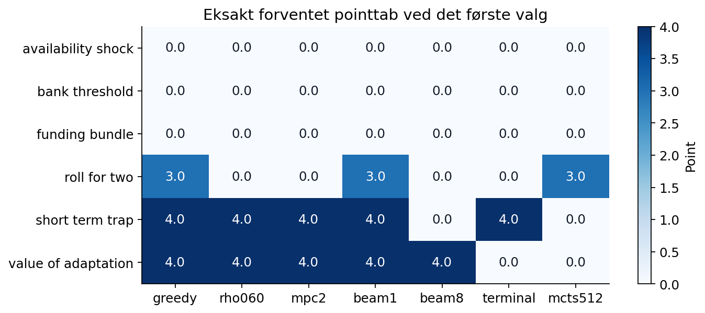
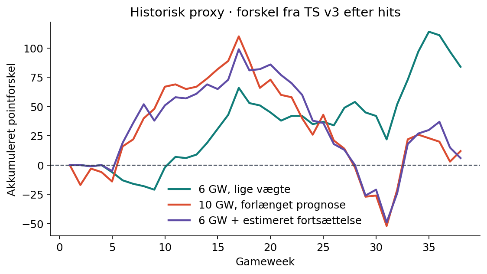

# Resultater · Dynamisk optimering af FPL-transfers

Studiet omfatter seks eksakte småcases og ét 38-runders replay med et fælles arkiv fra 2025/26. MM, PM og TS v3-koden er bevaret. Replayet er et diagnostisk eksperiment fra et ældre modelarkiv. Sæsonpoint fra en lækagefri sammenligning på den nuværende MM/PM-kæde kan først estimeres med flere originale deadlineprognoser og de tilhørende pristilstande.

## Audit af den frosne TS v3

- **Horisont.** TS v3 er allerede receding horizon med beam search og udfører kun første handling. Seks scorevægte fra (
ho=0,60) summerer til 2,38336. De første to runder bærer 67,1 % af vægten. Runde seks har 7,8 % af vægten i runde ét. Hits og det ekstra bufferpoint pr. betalt transfer diskonteres ikke. Den korte effektive horisont og hitbufferen ændrer dermed afvejningen mellem en gevinst nu og senere, også når prognosen har et stabilt flerugerssignal. [Frossen TS-konfiguration](../../integration/research-data/frozen-ts-config.json)
- **Roll og fleksibilitet.** Hold er altid en kandidat. Gratis transfers følger med i tilstanden og kan undgå fremtidige hits. Den ydre beam fastholder 20 tilstande per dybde og bruger kandidatgeneratorens højst 12 returnerede bundles per transferdybde. De sidste tilstande har ingen fortsættelsesværdi. Beam-rangeringen bruger optjente point plus vægtet score ved at holde den nuværende trup. Den giver ingen særskilt kredit til muligheden for senere at bruge en større bank, flere gratis transfers eller en fri klubplads. Det kan fjerne en god tilstand tidligt. Om roll undervurderes i gennemsnit er et empirisk spørgsmål.
- **Funding.** Den frosne fast-local-generator afviser isolerede trin med negativ vægtet spillergevinst og kræver budget og klubgrænse ved hvert trin. Dette kan fjerne en fælles lovlig bundle, selv hvis det endelige bytte er værdifuldt. PR #48 målte positivt søgegab i 11 af 30 deterministiske referencecases med den aktuelle worker. Den særskilte funding-kandidat gav nul forbedring i de ti fuldførte par i den efterfølgende real-pool-test. To af tolv par nåede tidsgrænsen. Det fund dokumenterer et søgeproblem og en praktisk omkostning ved at forsøge at løse det. [Eksakt worker-audit](https://github.com/pdamkier-del/fpl-analytics-app/pull/48) · [Real-pool-fundingforsøg](https://github.com/pdamkier-del/fpl-analytics-app/pull/57)
- **Irreversibilitet.** Den arkiverede TS-tilstand bærer bank, købspriser og FT og beregner lovlig salgsværdi ved hvert hypotetisk skridt. Markedspriser og klub er fastfrosset inden for en plan. En prisgevinst kan gøre tilbagekøb dyrere allerede ved en fast pris. Tilstandsprocessen i den nuværende plan lader fremtidige pris-, skade- og fixtureændringer materialisere sig ved den næste replanlægning, uden at modellere deres sandsynligheder i den nuværende transferbeslutning.
- **Kortsigtede køb.** Den eksakte case nedenfor viser mekanismen. Replayets tidlige videresalg opgøres som en andel af alle købene og bruges som adfærdsindikator. Et hurtigt salg kan også være rationelt ved skader, prisændringer eller opdaterede prognoser.

## Eksakte småproblemer

Optimalitetsgab er (max_a Q(s,a)-Q(s,hat a)), hvor begge førstevalg får eksakt optimal fortsættelse efter første beslutning. Målet isolerer førstevalgets kvalitet. Det fulde forventede policytab kan være større. De eksakte referencer summerer scenarieudfald ved deres oplyste sandsynlighed. Beam/MPC bruger en modal bane. `rho060` isolerer diskontering med fuld kandidatgenerering, officielle hits og uden buffer. Den er en mekanismetest ved siden af den frosne kontrol.

| Case | Eksakt værdi | Fund |
| --- | ---: | --- |
| Roll for two | 20 | Rul for at få to gratis transfers. Grådig strategi mister 3 point. En ekstra FT ved start er 1 point værd. |
| Funding bundle | 14 | −2 isoleret gevinst på funding-trinnet åbner et køb med +7. En ekstra pris­enhed er 3 point værd. |
| Short-term trap | 16 | Køb giver 2 point mere nu og gør tilbagekøb ufinansierbart. `rho060` og to-trins MPC taber 4 forventede point ved førstevalget. |
| Availability shock | 33,2 | 9,2 forventede point i værdi af at kunne vælge efter det næste chok, selv om den modale beam får førstevalget rigtigt. |
| Bank threshold | 6,5 | En ekstra £0,1m åbner køb og er 9 forventede point værd. Ekstra FT har nul værdi i samme tilstand. |
| Value of adaptation | 17 | En bred modal beam taber fortsat 4 point. En scenariebaseret ét-trins terminalværdi finder det optimale førstevalg. |

Korte eksakte fortsættelser fungerer som en lokal ADP-reference. De løser 5 af 6 førstevalg i disse cases. UCT ved 512 simulationer over 12 seeds vælger korrekt i fem cases, men mister 3 point på roll-casen i alle 12 forsøg. Et bredere beam kan reducere beskæring, men kan ikke genvinde værdien af en scenariegren, som slet ikke modelleres. En egentlig ADP til fuld skala kan lære (V) fra rollouts eller fra eksakte smådelproblemer med features for trup, købsværdi, FT, bank, klubpladser og resthorisont. Det historiske forsøg bruger den simplere fortsættelsesapproksimation beskrevet nedenfor. [Rå gap, seedvalg og tider](results/exact.json)

## Historisk undersøgelse

Alle arme starter fra det samme modelvalgte XV til £100m, nul gratis transfers før GW1 og de samme legale regler, prisinput, forecast-rækker og scoringsfunktioner. Kun første transferbeslutning udføres. Et klubskifte, som bringer en simuleret trup over klubgrænsen, repareres ens i alle arme og bruger de tilgængelige gratis transfers før øvrige køb. Matchpoint og minutter til scoring slås op efter låsning af de 38 beslutninger per arm. Valget af formation, XI, kaptajn og vice sker gennem den samme arkiverede `plan_squad`. Den historiske forslagsrangering modellerer en forventet vicebonus, mens realiseret scoring bruger autosubs. Den originale B-worker med fulde fælles scenarier blev undersøgt i den tidligere PR #48. Disse sæsontal er fra den ældre, fælles historiske scorer.

| Arm | Søgehorisont | Belønning under planlægning |
| --- | --- | --- |
| TS v3 | Seks arkiverede GW | 0,60-geometrisk score, frossen hitbuffer |
| MPC lige vægte | Seks arkiverede GW | Lige scorevægte, samme hits og buffer |
| MPC10 | Seks arkiverede GW plus op til fire ekstrapolerede GW | Lige scorevægte, hold seneste synlige point og P(spil) konstante i halen |
| Terminal8 | Seks arkiverede GW plus to estimerede fortsættelsestrin | Lige scorevægte. Tilføjer en totrins rollout gennem samme beam, så bank og FT påvirker handlemuligheder efter GW6 |

I Terminal8 justeres hale-xP med en nulskæringsregression på tidligere publiceringspar, hvor samme spiller og mål-GW gik fra lead 6 til lead 5. Kun ældre vintages bruges, og hale-(P(mathrm{spil})) holdes fast. (V) efter GW6 er approksimeret af beam-søgningens estimerede nettofortsættelse i to uger. Den består af en estimeret score og en faktisk overgangsmodel. Sammenligningen identificerer hverken regressionens isolerede værdi ved fast 8-GW-horisont eller værdien af ægte GW7–10-information. Alle optimeringsarme med historik bruger den samme kandidatmekanisme, så chok- og optimalitetsresultaterne kommer fra de eksakte cases. En eksakt sæsonoptimumværdi er ikke til rådighed.

### Resultater uden chips

| Arm | Point efter hits | Forskel | Hitpoint | Transfers | Roll | Salg inden for tre GW | Median sekunder/GW |
| --- | ---: | ---: | ---: | ---: | ---: | ---: | ---: |
| TS v3 | 1.964 | — | 16 | 41 | 1 | 5 (12 %) | 13,1 |
| MPC lige vægte | 2.048 | +84 | 76 | 56 | 1 | 14 (25 %) | 13,1 |
| MPC10 | 1.976 | +12 | 156 | 76 | 2 | 24 (32 %) | 15,3 |
| Terminal8 | 1.970 | +6 | 144 | 73 | 1 | 22 (30 %) | 12,9 |

Lige vægte gav +51 og +33 i de to sæsonhalvdele, og effekten er +54 til +104 ved at udelade én enkelt GW. Ved 3.000 parvise, cirkulære resamplinger af 4-GW-blokke er 5.–95.-percentilerne −49 til +231. Det er et følsomhedsmål på én genbrugt sæson. For MPC10 er de to halvdele +66 og −54, og for Terminal8 +82 og −76. For begge længere arme kan et enkelt GW ændre fortegnet på den samlede forskel. Beregningstider er observeret med overlappende processer på samme maskine.

Fra hver arms egen deadline-tilstand sammenlignede vi handlingens realiserede nettopoint med at rulle og genvælge XI og kaptajn på samme prognose. Summeret over runderne gav den lokale forskel +30 for TS v3, −5 for lige vægte, −135 for MPC10 og −74 for Terminal8. Summen har ingen effekt fra en alternativ roll-sti i senere runder. De længere arme accepterer flere umiddelbare pointtab i forventning om fremtidig gevinst. TS v3 havde færrest hits og den laveste andel tidlige videresalg i dette replay. Eksemplerne på intrinsisk myopi betyder derfor ikke, at den frosne kontrol videresælger hurtigere i denne proxy. Der er kun 1–2 rene rolls per arm, så sæsonen giver svagt grundlag for at sige, hvor tit roll burde vinde.

Seks uger med lige vægte er den bedst præsterende og enkleste historiske kandidat til senere sammenligning på originale vintages. De ekstrapolerede uger gav flere hits og færre sæsonpoint end den kandidat. De små scenarieforsøg viser værdien af selektivt at modellere et vigtigt chok. De begrunder et afgrænset scenarieforsøg, før man bruger en tungere MCTS eller træner en stor ADP/RL-model. [Ugeopgørelse](results/historical-weekly.csv) · [Resultatsammendrag](results/historical-summary.json)

### Særskilt Triple Captain-forsøg

Brug højst én andenhalvdel-TC i den første runde med mindst to kampe for den nominerede kaptajn i den udgivne prognose, med GW38 som fallback. Alle fire arme nominerede GW26 og fik tre ekstra faktiske point. Totalerne blev 1.967, 2.051, 1.979 og 1.973 i rækkefølgen ovenfor. Forsøget genbruger de låste transfers og formationer, så det måler chipvalg på de fire stier. Strategisk timing af flere chips og deres påvirkning af transferpolitikken kræver et særskilt forsøg. [TC-resultater per uge](results/historical-weekly.csv)

### Data- og validitetsgrænser

| Tilstandsdata | Hvad arkivet understøtter |
| --- | --- |
| Trup, bank, købsværdi og FT | Almindelige, simulerede stier fra et fælles seed. Ingen verificeret historisk privat state-log eller faktisk managereksekvering. |
| Markedspriser, klub og position | Et efterfølgende GW-datasæt. GW1 er et fælles seed. Replayets eksterne input bruger derpå senest observerede forrige GW. Originale GW-deadlinepriser, præcis status og flytninger mangler, og der er ingen historisk prisproces i de hypotetiske stier. |
| Skader og tilgængelighed | Proxy for spilchance i Phase5Q. Tidsstemplede skader, nyheder og registreringsstatus kan ikke rekonstrueres for alle deadlines. |
| Fixtures | Legacyprognosen er rekonstrueret fra den endelige sæsonkalender. Det kan give restlookahead for flyttede, blanke og dobbelte runder. |
| Point og minutter | Phase5Q leverer xP og marginal spilchance. Der findes ingen fuld sæson af originale, korrelerede MM/PM-scenarier på de samme deadlines. Arkivskaberen brugte estimerede deadlines og samme-GW metadata i prognosegenopbygningen. |
| Chips | Fælles chipfri tilstand. TC-overlay bruger højst én andenhalvdel-chip på en runde nomineret fra cutoff-prognosen. Historisk chipstatus og optimeret Wildcard, Free Hit og Bench Boost mangler. |

Kendte tidsfejl kommer fra inputarkivet og følger samtlige arme. Ingen metode får de realiserede fremtidige point eller minutter som optimeringsinput. Historikresultaterne kan hverken bruges som lækagefri måling af frossen MM/PM eller som sæsonprognose for produktion. Originale prognoseudgivelser fundet for 2026/27 dækkede GW12 og GW13 med seks runder per prognose. [Arkivets provenance og karantæne](https://github.com/pdamkier-del/fpl-analytics-app/blob/6d875a65251fb62f691dc0386ea81aeb29d27c0f/analysis/results/legacy-rolling-recovery-v1/manifest.json) · [Originale offentlige forecast-udgivelser](https://github.com/pdamkier-del/fpl-analytics-app/releases)
