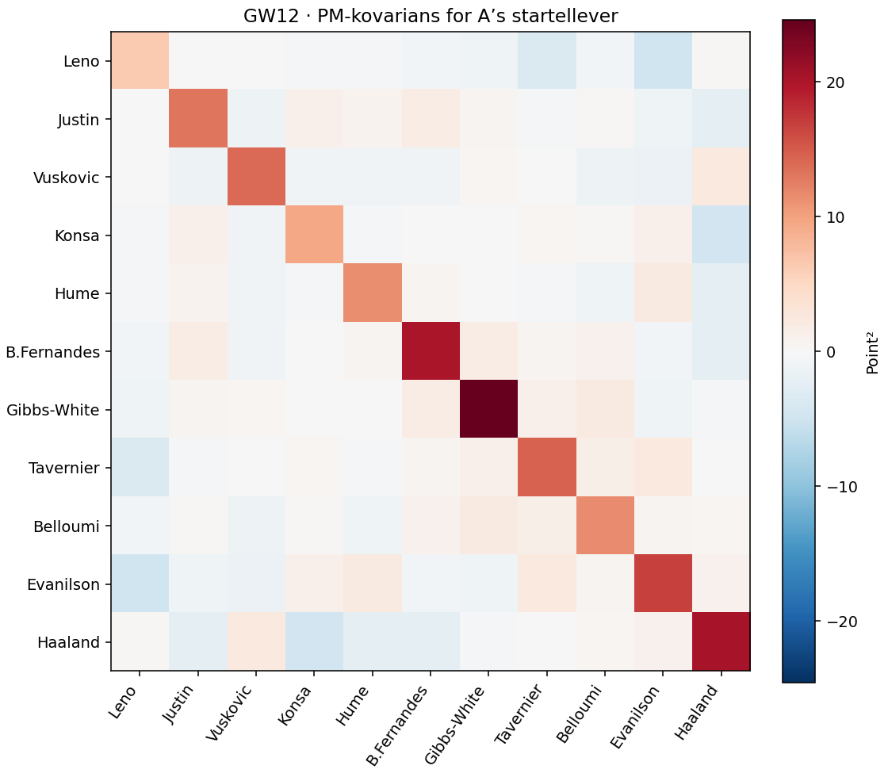
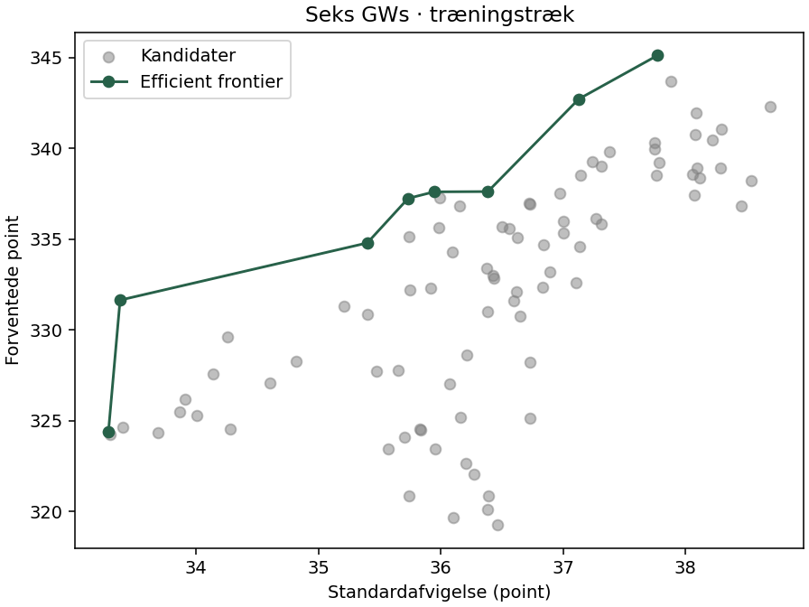
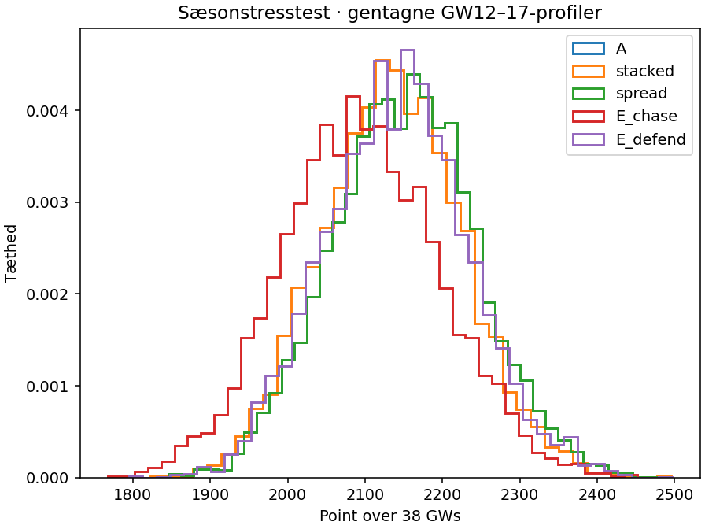

# FPL Research D · Porteføljeteori og korrelerede point

## Resultater

Korrelation flytter fordelingen for en fast additiv startellever. I seks GW12–17-profiler var den fælles varians for A’s additive XI fra 16 % lavere til 12 % højere end med spilleruafhængighed. For det fulde hold med autosubs og vicekaptajn gav marginalbevarende permutation 38,47 point i standardafvigelse mod 33,08 med fælles PM-træk. Forskellen i middelværdi mellem de to autosubberegninger må gerne være forskellig fra nul, da vægtene følger deltagelse. Begge estimater har Monte Carlo-støj.

| Par | Historisk rå | Historisk justeret (95 % blokinterval) | PM, GW12-origin | PM, GW13-origin |
|---|---:|---:|---:|---:|
| DEF–DEF, samme klub | 0,080 | 0,110 [0,093; 0,128] | 0,118 | 0,119 |
| GK–DEF, samme klub | 0,104 | 0,137 [0,123; 0,151] | 0,120 | 0,120 |
| MID–FWD, samme klub | 0,021 | 0,013 [−0,003; 0,025] | 0,020 | 0,019 |
| FWD–modstanderens DEF | −0,064 | −0,077 [−0,089; −0,063] | −0,074 | −0,072 |
| Konkurrence om GK-plads | −0,161 | −0,080 [−0,097; −0,064] | −0,089 | −0,090 |
| Forskellige kampe og klubber | 0,003 | 0,003 [−0,001; 0,005] | 0,001 | 0,000 |

Historikken er 2024/25, GW11–38, med en kronologisk residualmodel, hvor tidligere runder træner modellen. Den inkluderer hjemmebane, otte tidligere kampes scorebaserede angrebs- og forsvarsstyrke for begge klubber og spillerens seneste point. Spillere med nul minutter indgår. Intervallerne kommer fra cirkulær resampling af fire sammenhængende GWs ad gangen. PM-tallene er gennemsnit af parvise, betingede estimater for spillere med positive scenariovarianser og én kamp i den pågældende GW. Dækning og variansvægtning er forskellige. At fortegnene og størrelsesordenen ligner hinanden er en plausibilitetskontrol, og GW12 og GW13 overlapper i kampprogrammet.

A, B og C valgte samme trup blandt 90 kandidater ved henholdsvis højeste forventede point, laveste standardafvigelse inden for ét forventet point, og højeste sandsynlighed for strengt at slå 364 point. På de 200 separate PM-træk fik truppen **339,65 point i middelværdi**, **33,08 i standardafvigelse**, 10./50./90.-percentil **298/341/378**, og **22,0 %** sandsynlighed for at slå 364 (95 % MC-interval 16,8–28,2 %). CVaR var 79,90 points underskud i den værste tiendedel. Variansstraffen valgte først en anden kandidat ved 0,05 på det testede gitter. Den mest koncentrerede trup inden for fire træningspoint havde tre samme-klub-par, mod to for den mest spredte. Den gav 2,27 færre point over seks GWs (parret 95 % MC-interval −4,24 til −0,45). Den havde højere risiko i den direkte seks-GW-split og lidt lavere risiko i stresstesten, hvor kampugeprofiler resamples hver for sig. De to forsøg understøtter ingen robust fordel ved koncentration.

| Uger tilbage | D, indhent | E, indhent | Rullende mean, indhent | D/E, forsvar | Rullende mean, forsvar |
|---|---:|---:|---:|---:|---:|
| 24 | 38,2 % | 40,5 % | 36,8 % | 100 % | 70,0 % |
| 12 | 30,7 % | 39,4 % | 29,0 % | 100 % | 73,7 % |
| 6 | 21,2 % | 23,0 % | 19,0 % | 100 % | 79,3 % |

Den dynamiske jagtpolitik ofrede ca. 5–32 point i middelværdi mod den rullende mean-kontrol i 6–24-ugers kørslerne. I 38-ugers stresstesten faldt dens rivalchance til 39,8 % mod 46,1 % for den rullende mean-kontrol. Når man fører, kunne D og E kopiere den syntetiske rival, som beholdt samme trup hele perioden. Forsvarstallene viser effekten af det fælles matchup under præcis den antagelse. E er en myopisk politik med højst seks ugers beslutningshorisont. De tre faser ændrer de resterende uger i samme gentagne profiler, uden at ændre den underliggende kalender til faktiske sæsonfaser.







## Validering og afgrænsning

Kovariansregnestykket er verificeret mod lineær scoring pr. træk. Trænings- og holdout-splittene tester intern PM-stabilitet. På seks holdout-variansmål havde prøvens uklippede kovarians en gennemsnitlig absolutfejl på 40,9 point², mens den fuldt diagonale havde 34,5 point². Det lille antal mål og samme model på begge sider giver ikke grundlag for at vælge shrinkage til brug på rigtige kampe. Sæsonkørslen trækker 6.000 paths fra den faste holdout-pulje og gentager GW12–17-profiler. Intervallerne i JSON beskriver Monte Carlo-usikkerhed inden for den givne model. De inkluderer hverken modelparameterusikkerhed, fremtidig kalender, usikkerhed om sæsonens sammensætning eller fejl i skades- og prisprognoser.

De to arkiverede origins havde ingen officielt afsluttede inkluderede runder ved tjekket 28. november 2026. Derfor er kalibrering af PM’s fælles fordeling mod samtidige facit, sæsonreplay mod den låste TS v3 og rank- eller rivalvalidering på rigtige managerdata stadig åbne. Arkivets bootstrap indeholder samlet ownership pr. spiller. Fordelingen af samtidige managerlineups, kaptajner, hits, chips og udgangsrank er ikke tilgængelig i disse input. Ingen produktionskode, publicering eller kontrolkonfiguration indgår i ændringen.

## Reproduktion

Brug repoets `integration/research-data/releases.py` til at gendanne de offentlige arkivreleases og kontrollere deres receipter og hashes. Gem input og cache uden for researchmappen. Arkivtaggene og CSV-revisionen står i logbogen. Rapportens JSON har de konkrete inputhashes, alle tærskler, kvantiler, risikomål og parantal.

```sh
python -m pip install -r research/portfolio/requirements.txt
OPENBLAS_NUM_THREADS=1 python -m pytest -q research/portfolio tests/research_data
OPENBLAS_NUM_THREADS=1 MPLCONFIGDIR=work/mpl python research/portfolio/run.py \
  work/gw12/forecast.json.gz work/history.csv work/reproduced \
  --second-forecast work/gw13/forecast.json.gz
```

Se [matematik](MATHEMATICS.md), [PM-audit](AUDIT.md), [logbog](LOGBOOK.md) og [resultatdata](results/results.json).
